# Statistical Analysis of the UNSW-NB15 Network Traffic Dataset
### Parametric & Non-Parametric Inference, Confidence Intervals, and Empirical Scaling of Sample Size

[](https://www.python.org/)
[](LICENSE)
[](https://research.unsw.edu.au/projects/unsw-nb15-dataset)
[](#6-hypothesis-testing--inferential-statistics)
[](#10-reproducibility--execution-guide)

---

## Table of Contents
- [1. Executive Summary & Project Overview](#1-executive-summary--project-overview)
- [2. Dataset Architecture & Variable Definitions](#2-dataset-architecture--variable-definitions)
- [3. Mathematical Formulations & Statistical Methods](#3-mathematical-formulations--statistical-methods)
- [4. Descriptive Statistics & Distributional Properties](#4-descriptive-statistics--distributional-properties)
- [5. Confidence Intervals Across Sample Sizes](#5-confidence-intervals-across-sample-sizes)
- [6. Hypothesis Testing & Inferential Statistics](#6-hypothesis-testing--inferential-statistics)
  - [6.1 T1: Welch's Two-Sample t-Test (dmean: Normal vs. Attack)](#61-t1-welchs-two-sample-t-test-dmean-normal-vs-attack)
  - [6.2 T2: Chi-Square Test of Independence (Protocol Group × Label)](#62-t2-chi-square-test-of-independence-protocol-group--label)
  - [6.3 T3: One-Way ANOVA (smean Across Top 6 Attack Categories)](#63-t3-one-way-anova-smean-across-top-6-attack-categories)
  - [6.4 T4: Bivariate Correlation Analysis (sbytes vs. dbytes: Pearson vs. Spearman)](#64-t4-bivariate-correlation-analysis-sbytes-vs-dbytes-pearson-vs-spearman)
- [7. Empirical Synthesis: The Effect of Sample Size](#7-empirical-synthesis-the-effect-of-sample-size)
- [8. Literature Benchmark & Context (2025–2026)](#8-literature-benchmark--context-20252026)
- [9. Repository Structure](#9-repository-structure)
- [10. Reproducibility & Execution Guide](#10-reproducibility--execution-guide)
- [11. References & Citation](#11-references--citation)

---

## 1. Executive Summary & Project Overview

This repository provides an empirical, end-to-end statistical analysis of the **UNSW-NB15** network security dataset, created by the Australian Centre for Cyber Security (ACCS) using an IXIA PerfectStorm cyber range. The complete dataset aggregates **$N = 257,673$ network flows** across 49 features, capturing realistic modern normal traffic and nine distinct synthetic cyber-attack families.

### Core Objectives
1. **Descriptive Characterization**: Quantify central tendency, dispersion, extreme skewness, and heavy-tailed kurtosis across key network flow metrics (`dur`, `sbytes`, `dbytes`, `rate`, `smean`, `dmean`).
2. **Interval Estimation**: Construct $95\%$ Student's $t$ confidence intervals for continuous population means and Wilson score intervals for the population attack proportion.
3. **Hypothesis Testing**: Formulate and evaluate four distinct statistical hypothesis tests ($\alpha = 0.05$):
   - **T1**: Welch's two-sample $t$-test (Destination packet size: Normal vs. Attack)
   - **T2**: Pearson's Chi-square ($\chi^2$) test of independence (Transport Protocol vs. Attack Label)
   - **T3**: One-way Analysis of Variance (ANOVA) (Source packet size across attack families)
   - **T4**: Bivariate correlation analysis contrasting Pearson linear correlation $r$ against Spearman monotonic rank correlation $\rho$.
4. **Empirical Effect of Sample Size**: Evaluate all statistical estimators and test dynamics across four sample tiers:
   - Simple Random Sample (SRS) with Seed $11$: **$n = 500$**
   - Simple Random Sample (SRS) with Seed $22$: **$n = 2,000$**
   - Simple Random Sample (SRS) with Seed $33$: **$n = 10,000$**
   - Full Population Reference: **$N = 257,673$**
5. **Methodological Rigor**: Contrast $p$-value inflation in large datasets against invariant effect size measures ($\text{Cohen's } d$, $\text{Cramér's } V$, $\eta^2$, $\rho$), demonstrating the classic "Big Data $p$-value paradox."

---

## 2. Dataset Architecture & Variable Definitions

The corpus combines the standardized training partition ($175,341$ records) and testing partition ($82,332$ records) into a consolidated population of **$N = 257,673$ records**.

### 2.1 Class & Protocol Distributions
- **Binary Traffic Classification (`label`)**:
  - **Normal (`0`)**: $93,000$ records ($36.09\%$)
  - **Attack (`1`)**: $164,673$ records ($63.91\%$)
- **Multi-Class Attack Taxonomy (`attack_cat`)**:
  - `Generic`: $58,871$ ($22.85\%$)
  - `Exploits`: $44,525$ ($17.28\%$)
  - `Fuzzers`: $24,246$ ($9.41\%$)
  - `DoS`: $16,353$ ($6.35\%$)
  - `Reconnaissance`: $13,987$ ($5.43\%$)
  - `Analysis`: $2,677$ ($1.04\%$)
  - `Backdoor`: $2,329$ ($0.90\%$)
  - `Shellcode`: $1,511$ ($0.59\%$)
  - `Worms`: $174$ ($0.07\%$)
- **Protocol Aggregation (`proto_grp`)**:
  - `tcp`: $123,041$ ($47.75\%$)
  - `udp`: $92,701$ ($35.98\%$)
  - `other` (unas, arp, ospf, etc.): $41,931$ ($16.27\%$)

<p align="center">
  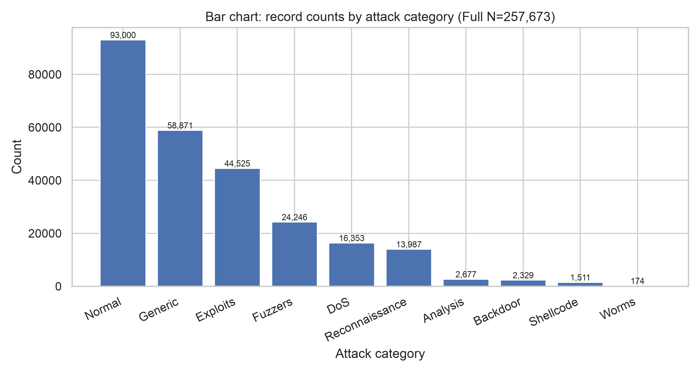
  <br>
  <em>Figure 1: Record frequency across attack categories in the UNSW-NB15 dataset (N = 257,673).</em>
</p>

### 2.2 Selected Continuous Features
Six continuous features representing temporal duration, byte volumes, throughput rates, and packet sizing were selected for in-depth statistical modeling:

| Variable | Unit | Definition | Observed Domain | Statistical Character |
| :--- | :--- | :--- | :--- | :--- |
| `dur` | Seconds | Connection record duration | $[0.0, 59.999]$ | Extreme right skew; median $= 0.0043\text{ s}$ vs. mean $= 1.25\text{ s}$ |
| `sbytes` | Bytes | Source-to-destination transaction bytes | $[24, 14,355,774]$ | Heavy-tailed Pareto behavior; median $= 528\text{ B}$ vs. mean $= 8,573\text{ B}$ |
| `dbytes` | Bytes | Destination-to-source transaction bytes | $[0, 14,657,531]$ | $46.7\%$ zero-inflated (unidirectional attacks); median $= 178\text{ B}$ |
| `rate` | Pkts/s | Total connection packet rate | $[0, 1,000,000]$ | Bimodal burst structure; attacks exhibit substantially higher rates |
| `smean` | Bytes | Mean packet size transmitted by source | $[24, 1,504]$ | Physically bounded by Ethernet MTU; median $= 73\text{ B}$ |
| `dmean` | Bytes | Mean packet size transmitted by destination | $[0, 1,500]$ | Bounded by MTU; highly discriminative between normal and attack flows |

---

## 3. Mathematical Formulations & Statistical Methods

### 3.1 Point Estimates & Dispersion Metrics
For an i.i.d. sample $\{x_1, x_2, \dots, x_n\}$:

- **Sample Mean**:
  $$\bar{x} = \frac{1}{n} \sum_{i=1}^n x_i$$
- **Sample Variance (Bessel's Correction)**:
  $$s^2 = \frac{1}{n-1} \sum_{i=1}^n (x_i - \bar{x})^2$$
- **Sample Standard Deviation & Standard Error**:
  $$s = \sqrt{s^2}, \qquad \text{SE}(\bar{x}) = \frac{s}{\sqrt{n}}$$
- **Coefficient of Variation**:
  $$\text{CV} = \frac{s}{\bar{x}} \quad (\bar{x} \neq 0)$$
- **Quartile Dispersion**:
  $$\text{IQR} = Q_3 - Q_1 = F^{-1}(0.75) - F^{-1}(0.25)$$
- **Sample Skewness ($g_1$) & Excess Kurtosis ($g_2$)**:
  $$g_1 = \frac{\frac{1}{n}\sum_{i=1}^n (x_i - \bar{x})^3}{\left[\frac{1}{n}\sum_{i=1}^n (x_i - \bar{x})^2\right]^{3/2}}, \qquad g_2 = \frac{\frac{1}{n}\sum_{i=1}^n (x_i - \bar{x})^4}{\left[\frac{1}{n}\sum_{i=1}^n (x_i - \bar{x})^2\right]^2} - 3$$

---

### 3.2 Interval Estimation (Confidence Intervals)

#### Student's $t$ Interval for Population Mean $\mu$:
Under the Central Limit Theorem (CLT), for $1 - \alpha = 0.95$:
$$\text{CI}_{0.95}(\mu) = \left[ \bar{x} - t_{1-\alpha/2, \, n-1} \cdot \frac{s}{\sqrt{n}}, \;\; \bar{x} + t_{1-\alpha/2, \, n-1} \cdot \frac{s}{\sqrt{n}} \right]$$

#### Confidence Intervals for Population Proportion $p$:
Given $k = \sum_{i=1}^n \mathbb{I}(y_i = 1)$ and $\hat{p} = \frac{k}{n}$, with critical value $z = \Phi^{-1}(1 - \alpha/2) = 1.95996$:
1. **Wald (Standard Normal Approximation)**:
   $$\text{CI}_{\text{Wald}} = \hat{p} \pm z \sqrt{\frac{\hat{p}(1 - \hat{p})}{n}}$$
2. **Wilson Score Interval (Continuity/Skewness Robust)**:
   $$\text{CI}_{\text{Wilson}} = \frac{\hat{p} + \frac{z^2}{2n}}{1 + \frac{z^2}{n}} \pm \frac{z}{1 + \frac{z^2}{n}} \sqrt{\frac{\hat{p}(1-\hat{p})}{n} + \frac{z^2}{4n^2}}$$

---

### 3.3 Hypothesis Testing Frameworks

#### T1: Welch's Two-Sample $t$-Test (Heteroscedastic Difference in Means)
Given groups $1$ (Normal) and $2$ (Attack) with sample sizes $n_1, n_2$, means $\bar{x}_1, \bar{x}_2$, and sample variances $s_1^2, s_2^2$:
- **Hypotheses**: $H_0: \mu_1 - \mu_2 = 0 \quad \text{vs.} \quad H_1: \mu_1 - \mu_2 \neq 0$
- **Test Statistic**:
  $$t = \frac{\bar{x}_1 - \bar{x}_2}{\sqrt{\frac{s_1^2}{n_1} + \frac{s_2^2}{n_2}}}$$
- **Welch–Satterthwaite Effective Degrees of Freedom**:
  $$\nu \approx \frac{\left(\frac{s_1^2}{n_1} + \frac{s_2^2}{n_2}\right)^2}{\frac{(s_1^2 / n_1)^2}{n_1 - 1} + \frac{(s_2^2 / n_2)^2}{n_2 - 1}}$$
- **Standardized Effect Size (Cohen's $d$)**:
  $$d = \frac{\bar{x}_1 - \bar{x}_2}{s_p}, \qquad s_p = \sqrt{\frac{(n_1 - 1)s_1^2 + (n_2 - 1)s_2^2}{n_1 + n_2 - 2}}$$

#### T2: Pearson's Chi-Square ($\chi^2$) Test of Independence
Testing association between protocol group ($r=3$ rows) and traffic class ($c=2$ columns):
- **Hypotheses**: $H_0: P(A_i \cap B_j) = P(A_i)P(B_j) \quad \text{vs.} \quad H_1: P(A_i \cap B_j) \neq P(A_i)P(B_j)$
- **Test Statistic**:
  $$\chi^2 = \sum_{i=1}^r \sum_{j=1}^c \frac{(O_{ij} - E_{ij})^2}{E_{ij}}, \qquad E_{ij} = \frac{R_i \cdot C_j}{N}, \qquad \text{df} = (r-1)(c-1) = 2$$
- **Effect Size (Cramér's $V$)**:
  $$V = \sqrt{\frac{\chi^2}{N \cdot \min(r-1, c-1)}} = \sqrt{\frac{\chi^2}{N \cdot 1}}$$

#### T3: One-Way Analysis of Variance (ANOVA)
Testing equality of source packet size ($\text{smean}$) across $k=6$ dominant attack categories:
- **Hypotheses**: $H_0: \mu_1 = \mu_2 = \dots = \mu_6 \quad \text{vs.} \quad H_1: \exists \, (i, j) \text{ s.t. } \mu_i \neq \mu_j$
- **Sums of Squares & Test Statistic**:
  $$\text{SSB} = \sum_{j=1}^k n_j (\bar{x}_j - \bar{x})^2, \qquad \text{SSW} = \sum_{j=1}^k \sum_{i=1}^{n_j} (x_{ij} - \bar{x}_j)^2, \qquad \text{SST} = \text{SSB} + \text{SSW}$$
  $$F = \frac{\text{MSB}}{\text{MSW}} = \frac{\text{SSB} / (k - 1)}{\text{SSW} / (N - k)} \sim F_{k-1, \, N-k}$$
- **Effect Size ($\eta^2$, Eta-Squared)**:
  $$\eta^2 = \frac{\text{SSB}}{\text{SST}}$$

#### T4: Correlation Analysis (Pearson $r$ vs. Spearman $\rho$)
- **Pearson Product-Moment Correlation**:
  $$r = \frac{\sum_{i=1}^n (x_i - \bar{x})(y_i - \bar{y})}{\sqrt{\sum_{i=1}^n (x_i - \bar{x})^2 \sum_{i=1}^n (y_i - \bar{y})^2}}$$
- **Fisher $z$-Transformation for $95\%$ CI of Pearson $r$**:
  $$z_r = \operatorname{arctanh}(r) = \frac{1}{2} \ln \left(\frac{1+r}{1-r}\right), \qquad \text{SE}_z = \frac{1}{\sqrt{n - 3}}$$
  $$\text{CI}_{0.95}(r) = \left[ \tanh(z_r - 1.96 \cdot \text{SE}_z), \;\; \tanh(z_r + 1.96 \cdot \text{SE}_z) \right]$$
- **Spearman Rank-Order Correlation**:
  $$\rho = 1 - \frac{6 \sum_{i=1}^n d_i^2}{n(n^2 - 1)}, \qquad d_i = \operatorname{rank}(x_i) - \operatorname{rank}(y_i)$$

---

## 4. Descriptive Statistics & Distributional Properties

### 4.1 Full Population Benchmark ($N = 257,673$)
The table below presents the population statistics calculated on the entire dataset:

| Variable | Count | Mean ($\bar{x}$) | Median | Std ($s$) | Variance ($s^2$) | Min | Max | Q1 | Q3 | IQR | Skew ($g_1$) | Kurtosis ($g_2$) | SE ($\bar{x}$) |
| :--- | :--- | :--- | :--- | :--- | :--- | :--- | :--- | :--- | :--- | :--- | :--- | :--- | :--- |
| `dur` | $257,673$ | $1.2467$ | $0.0043$ | $5.9743$ | $35.69$ | $0.00$ | $60.00$ | $0.0000$ | $0.6858$ | $0.6858$ | $+8.02$ | $+68.04$ | $0.0118$ |
| `sbytes` | $257,673$ | $8,572.95$ | $528.00$ | $173,773.88$ | $3.02 \times 10^{10}$ | $24.00$ | $1.44 \times 10^7$ | $114.00$ | $1,362.00$ | $1,248.00$ | $+47.92$ | $+2,616.45$ | $342.33$ |
| `dbytes` | $257,673$ | $14,387.29$ | $178.00$ | $146,199.28$ | $2.14 \times 10^{10}$ | $0.00$ | $1.47 \times 10^7$ | $0.00$ | $1,064.00$ | $1,064.00$ | $+44.34$ | $+3,272.28$ | $288.01$ |
| `rate` | $257,673$ | $91,253.91$ | $2,955.66$ | $160,344.64$ | $2.57 \times 10^{10}$ | $0.00$ | $1.00 \times 10^6$ | $30.79$ | $125,000.00$ | $124,969.21$ | $+3.38$ | $+14.98$ | $315.88$ |
| `smean` | $257,673$ | $137.64$ | $73.00$ | $205.90$ | $42,395.27$ | $24.00$ | $1,504.00$ | $57.00$ | $100.00$ | $43.00$ | $+3.67$ | $+13.70$ | $0.4056$ |
| `dmean` | $257,673$ | $121.65$ | $44.00$ | $254.04$ | $64,536.84$ | $0.00$ | $1,500.00$ | $0.00$ | $89.00$ | $89.00$ | $+2.91$ | $+8.26$ | $0.5005$ |

<p align="center">
  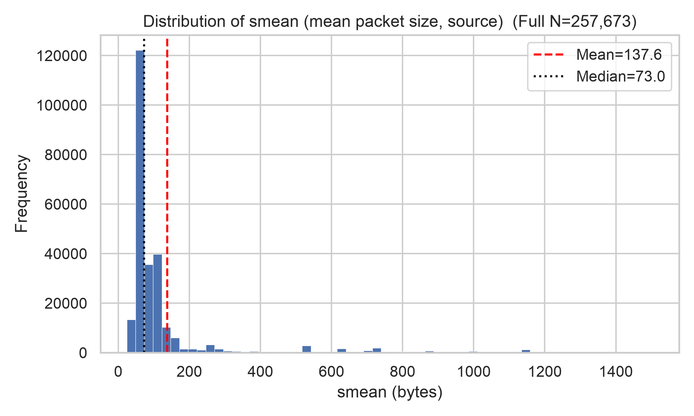
  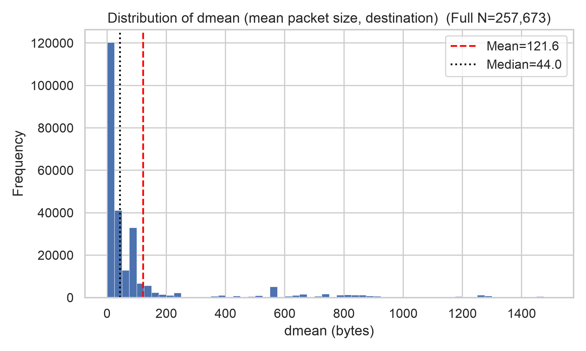
  <br>
  <em>Figure 2: Empirical distributions of packet sizing metrics (smean and dmean). Both display severe right-skewness where the parametric mean (red dashed line) substantially exceeds the median (black dotted line).</em>
</p>

### 4.2 Sample Size Scaling Behavior: The Case of `dmean`
Examining `dmean` across sample sizes illustrates how point estimates converge rapidly while standard errors collapse as $1/\sqrt{n}$:

| Sample Size ($n$) | Mean ($\bar{x}$) | Median | Variance ($s^2$) | Std ($s$) | Skewness ($g_1$) | Kurtosis ($g_2$) | Standard Error ($\text{SE}$) |
| :--- | :--- | :--- | :--- | :--- | :--- | :--- | :--- |
| **$n = 500$** | $123.4300$ | $44.00$ | $65,370.85$ | $255.6772$ | $+2.8292$ | $+7.8096$ | $11.4342$ |
| **$n = 2,000$** | $123.3375$ | $44.00$ | $63,705.25$ | $252.3990$ | $+2.8324$ | $+7.7194$ | $5.6438$ |
| **$n = 10,000$** | $125.2448$ | $44.00$ | $66,999.08$ | $258.8418$ | $+2.8197$ | $+7.6441$ | $2.5884$ |
| **Full ($N = 257,673$)** | $121.6497$ | $44.00$ | $64,536.84$ | $254.0410$ | $+2.9101$ | $+8.2608$ | $0.5005$ |

> [!NOTE]
> **Key Insight**: The median is exactly **$44.00\text{ bytes}$** across every single sample size, underscoring its robustness as an estimator of location in skewed traffic. Meanwhile, $\text{SE}(\bar{x})$ declines from $11.43$ at $n=500$ down to $0.50$ in the full population—a $22.8\times$ reduction governed precisely by $\sqrt{257,673 / 500} \approx 22.7$.

<p align="center">
  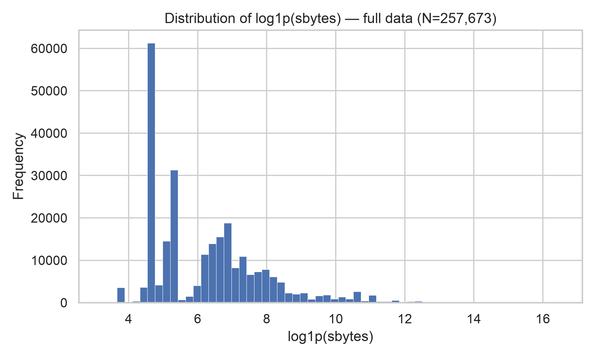
  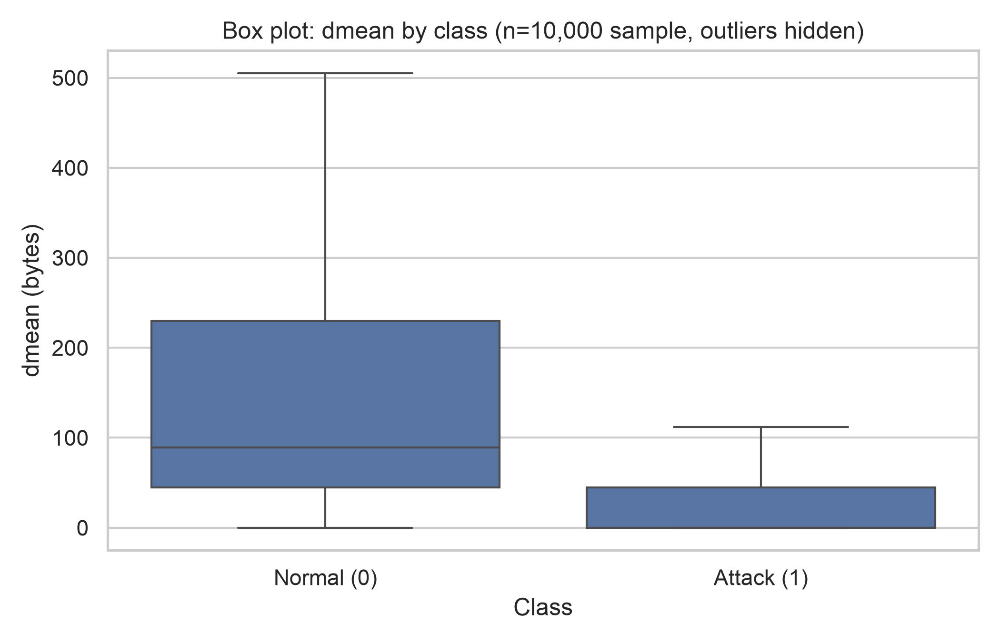
  <br>
  <em>Figure 3: (Left) $\log_{1p}(\text{sbytes})$ distribution resolving extreme 5-decade skew into a readable bimodal structure. (Right) Boxplot of dmean partitioned by class (Normal vs. Attack) at n = 10,000, revealing clean distributional separation.</em>
</p>

---

## 5. Confidence Intervals Across Sample Sizes

### 5.1 95% Confidence Intervals for Continuous Means (Student's $t$)

| Variable | Metric | $n = 500$ | $n = 2,000$ | $n = 10,000$ | Full Population ($N = 257,673$) |
| :--- | :--- | :--- | :--- | :--- | :--- |
| **`dmean`** | Point Mean ($\bar{x}$)<br>$95\%$ CI<br>**CI Width** | $123.43$<br>$[100.96, 145.90]$<br>**$44.93$** | $123.34$<br>$[112.27, 134.41]$<br>**$22.14$** | $125.24$<br>$[120.17, 130.32]$<br>**$10.15$** | $121.65$<br>$[120.67, 122.63]$<br>**$1.96$** |
| **`smean`** | Point Mean ($\bar{x}$)<br>$95\%$ CI<br>**CI Width** | $140.30$<br>$[121.27, 159.32]$<br>**$38.05$** | $142.29$<br>$[132.87, 151.72]$<br>**$18.85$** | $132.45$<br>$[128.56, 136.35]$<br>**$7.79$** | $137.64$<br>$[136.84, 138.43]$<br>**$1.59$** |
| **`dur`** | Point Mean ($\bar{x}$)<br>$95\%$ CI<br>**CI Width** | $1.166$<br>$[0.644, 1.688]$<br>**$1.044$** | $1.158$<br>$[0.913, 1.403]$<br>**$0.490$** | $1.210$<br>$[1.095, 1.325]$<br>**$0.230$** | $1.247$<br>$[1.224, 1.270]$<br>**$0.046$** |
| **`sbytes`** | Point Mean ($\bar{x}$)<br>$95\%$ CI<br>**CI Width** | $4,310.90$<br>$[2,641.68, 5,980.11]$<br>**$3,338.43$** | $8,999.40$<br>$[2,840.12, 15,158.67]$<br>**$12,318.55$** | $7,580.83$<br>$[5,177.99, 9,983.67]$<br>**$4,805.68$** | $8,572.95$<br>$[7,901.99, 9,243.92]$<br>**$1,341.93$** |
| **`dbytes`** | Point Mean ($\bar{x}$)<br>$95\%$ CI<br>**CI Width** | $13,629.54$<br>$[5,868.96, 21,390.12]$<br>**$15,521.16$** | $13,152.73$<br>$[8,272.94, 18,032.51]$<br>**$9,759.57$** | $13,972.53$<br>$[12,008.53, 15,936.54]$<br>**$3,928.01$** | $14,387.29$<br>$[13,822.80, 14,951.78]$<br>**$1,128.98$** |
| **`rate`** | Point Mean ($\bar{x}$)<br>$95\%$ CI<br>**CI Width** | $85,286.35$<br>$[73,554.14, 97,018.55]$<br>**$23,464.41$** | $88,307.71$<br>$[81,608.94, 95,006.49]$<br>**$13,397.55$** | $90,083.38$<br>$[86,973.92, 93,192.84]$<br>**$6,218.93$** | $91,253.91$<br>$[90,634.80, 91,873.02]$<br>**$1,238.22$** |

<p align="center">
  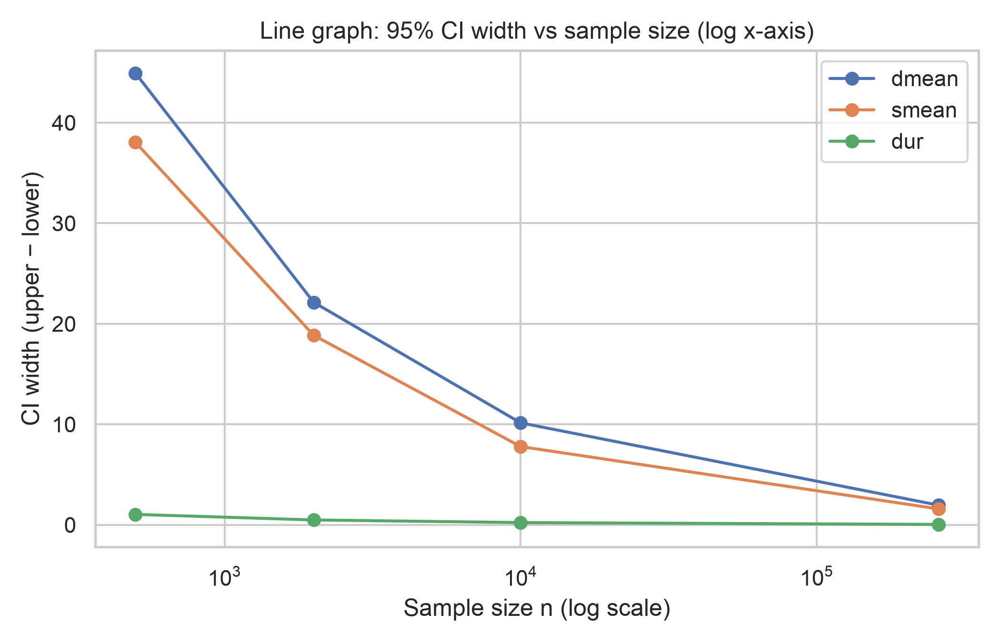
  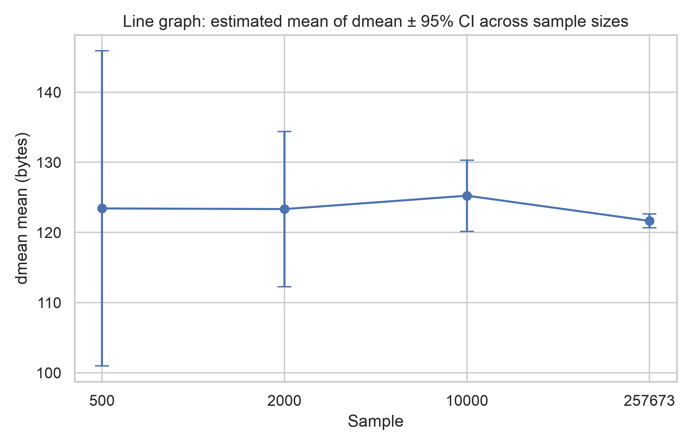
  <br>
  <em>Figure 4: (Left) Log-log plot of 95% CI width vs. sample size n confirming strict $1/\sqrt{n}$ decay. (Right) Stability of point estimate \bar{x}_{\text{dmean}} across sample sizes alongside shrinking 95% confidence bounds.</em>
</p>

### 5.2 95% Confidence Intervals for Population Attack Proportion $P(\text{Attack})$
Evaluating the empirical attack proportion $\hat{p} = \frac{\text{attacks}}{n}$:

| Sample Size ($n$) | Attack Count ($k$) | Point Estimate ($\hat{p}$) | $95\%$ Wald CI | $95\%$ Wilson Score CI | Wilson Width ($\Delta$) |
| :--- | :--- | :--- | :--- | :--- | :--- |
| **$n = 500$** | $315$ | $0.6300$ ($63.00\%$) | $[0.5877, 0.6723]$ | $[0.5868, 0.6712]$ | $0.0843$ ($\pm 4.2\%$) |
| **$n = 2,000$** | $1,303$ | $0.6515$ ($65.15\%$) | $[0.6306, 0.6724]$ | $[0.6303, 0.6721]$ | $0.0417$ ($\pm 2.1\%$) |
| **$n = 10,000$** | $6,366$ | $0.6366$ ($63.66\%$) | $[0.6272, 0.6460]$ | $[0.6271, 0.6460]$ | $0.0189$ ($\pm 0.9\%$) |
| **Full ($N = 257,673$)** | $164,673$ | $0.6391$ ($63.91\%$) | $[0.6372, 0.6409]$ | $[0.6372, 0.6409]$ | $0.0037$ ($\pm 0.18\%$) |

All intervals cross-validate and capture the population proportion ($63.91\%$). Even at $n=500$, the Wilson score interval isolates the attack share within an $8.4\%$ band.

---

## 6. Hypothesis Testing & Inferential Statistics

All hypothesis tests were evaluated at a significance threshold of **$\alpha = 0.05$**.

---

### 6.1 T1: Welch's Two-Sample t-Test (dmean: Normal vs. Attack)
- **Null Hypothesis ($H_0$)**: $\mu_{\text{Normal}} = \mu_{\text{Attack}}$ (mean destination packet size is identical)
- **Alternative Hypothesis ($H_1$)**: $\mu_{\text{Normal}} \neq \mu_{\text{Attack}}$ (two-sided)

| Sample ($n$) | $n_{\text{norm}}$ | $n_{\text{atk}}$ | $\bar{x}_{\text{norm}}$ (B) | $\bar{x}_{\text{atk}}$ (B) | Difference ($\Delta$) | Welch $t$-Stat | Welch df ($\nu$) | $p$-Value | $95\%$ CI of Difference | Cohen's $d$ | Decision ($\alpha=0.05$) |
| :--- | :--- | :--- | :--- | :--- | :--- | :--- | :--- | :--- | :--- | :--- | :--- |
| **$n = 500$** | $185$ | $315$ | $222.08$ | $65.50$ | $+156.58$ | $6.228$ | $277.9$ | $1.74 \times 10^{-9}$ | $[107.08, 206.08]$ | $0.640$ | **Reject $H_0$** |
| **$n = 2,000$** | $697$ | $1,303$ | $222.67$ | $70.20$ | $+152.46$ | $12.067$ | $1,060.1$ | $1.64 \times 10^{-31}$ | $[127.67, 177.25]$ | $0.631$ | **Reject $H_0$** |
| **$n = 10,000$** | $3,634$ | $6,366$ | $231.65$ | $64.50$ | $+167.15$ | $28.868$ | $5,232.5$ | $3.62 \times 10^{-170}$ | $[155.80, 178.50]$ | $0.679$ | **Reject $H_0$** |
| **Full ($N = 257,673$)** | $93,000$ | $164,673$ | $221.43$ | $65.30$ | $+156.13$ | $139.674$ | $137,329.6$ | $\approx 0.0$ | $[153.94, 158.32]$ | $0.643$ | **Reject $H_0$** |

<p align="center">
  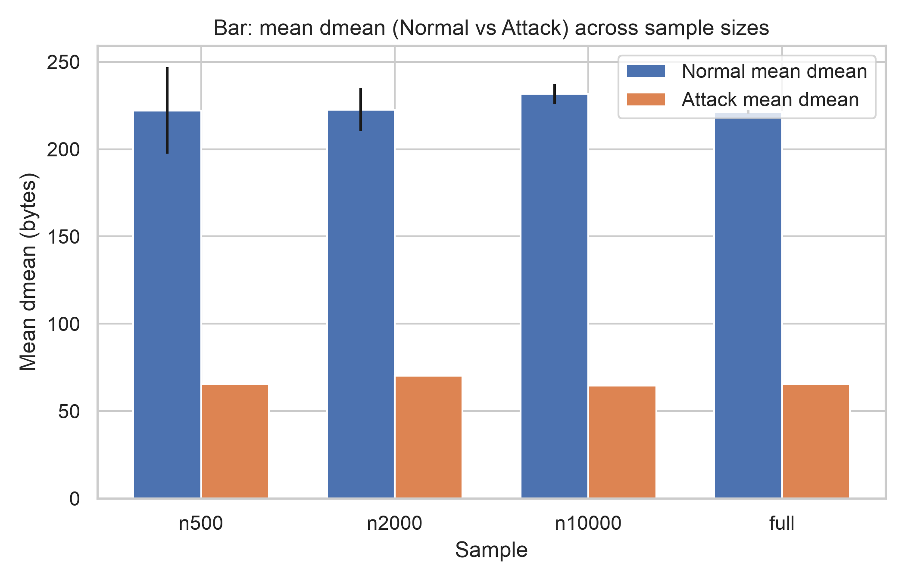
  <br>
  <em>Figure 5: Mean destination packet size (dmean) for Normal vs. Attack traffic across all sample sizes. The empirical difference (~156 bytes) is invariant to sample size.</em>
</p>

> [!IMPORTANT]
> **Inferential Takeaway**: $H_0$ is decisively rejected across all sample tiers ($p < 10^{-8}$). Normal connections elicit substantially larger destination packet replies ($\sim 221\text{ B}$ vs. $\sim 65\text{ B}$) because benign requests retrieve actual payload data, whereas attacks primarily comprise probes, scans, or one-way floods. Notice that **Cohen's $d \approx 0.64$** (medium-large effect) is completely stable from $n=500$ to $N=257,673$; increasing $n$ only inflates $t$ and contracts the confidence band around the difference from $99.0\text{ B}$ to $4.38\text{ B}$.

---

### 6.2 T2: Chi-Square Test of Independence (Protocol Group × Label)
- **Null Hypothesis ($H_0$)**: Transport protocol (`tcp`, `udp`, `other`) and connection class (`Normal`, `Attack`) are statistically independent.
- **Alternative Hypothesis ($H_1$)**: Protocol and connection class are statistically dependent.

#### Full Population ($N = 257,673$) Contingency Matrix:
| Protocol Group | Normal Count ($O_{i0}$) | Attack Count ($O_{i1}$) | Row Total | Normal % | Attack % | Expected Normal ($E_{i0}$) | Expected Attack ($E_{i1}$) |
| :--- | :--- | :--- | :--- | :--- | :--- | :--- | :--- |
| **`tcp`** | $66,969$ | $56,072$ | $123,041$ | $54.43\%$ | $45.57\%$ | $44,408.27$ | $78,632.73$ |
| **`udp`** | $22,019$ | $70,682$ | $92,701$ | $23.75\%$ | $76.25\%$ | $33,457.88$ | $59,243.12$ |
| **`other`** | $4,012$ | $37,919$ | $41,931$ | $9.57\%$ | $90.43\%$ | $15,133.84$ | $26,797.16$ |
| **Total** | $93,000$ | $164,673$ | $257,673$ | $36.09\%$ | $63.91\%$ | $93,000.00$ | $164,673.00$ |

#### Inferential Statistics Across Sample Tiers:
| Sample ($n$) | Total $n$ | Pearson $\chi^2$ | Degrees of Freedom ($\text{df}$) | $p$-Value | Cramér's $V$ | Association Strength | Decision ($\alpha=0.05$) |
| :--- | :--- | :--- | :--- | :--- | :--- | :--- | :--- |
| **$n = 500$** | $500$ | $75.76$ | $2$ | $3.53 \times 10^{-17}$ | $0.3893$ | Moderate-Strong | **Reject $H_0$** |
| **$n = 2,000$** | $2,000$ | $281.72$ | $2$ | $6.68 \times 10^{-62}$ | $0.3753$ | Moderate-Strong | **Reject $H_0$** |
| **$n = 10,000$** | $10,000$ | $1,528.71$ | $2$ | $\approx 0.0$ | $0.3910$ | Moderate-Strong | **Reject $H_0$** |
| **Full ($N = 257,673$)** | $257,673$ | $36,843.39$ | $2$ | $\approx 0.0$ | $0.3781$ | Moderate-Strong | **Reject $H_0$** |

<p align="center">
  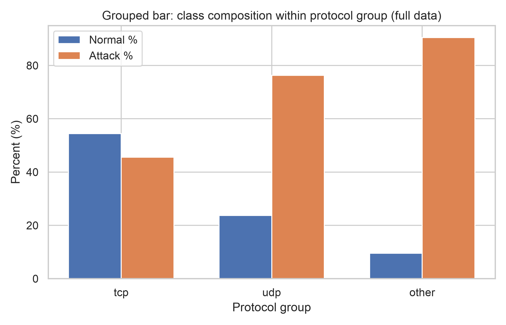
  <br>
  <em>Figure 6: Percentage breakdown of Normal vs. Attack traffic within each transport protocol group.</em>
</p>

> [!NOTE]
> **Inferential Takeaway**: Protocol choice heavily predicts malicious activity: `tcp` carries over $54\%$ normal traffic, `udp` is over $76\%$ attack, and esoteric protocols (`other`) are over $90\%$ attack traffic. Notice how $\chi^2$ scales directly with $N$ ($75.8 \to 281.7 \to 1,528.7 \to 36,843.4$), whereas **Cramér's $V \approx 0.38$** remains completely invariant across all sample tiers.

---

### 6.3 T3: One-Way ANOVA (smean Across Top 6 Attack Categories)
- **Null Hypothesis ($H_0$)**: $\mu_{\text{Normal}} = \mu_{\text{Generic}} = \mu_{\text{Exploits}} = \mu_{\text{Fuzzers}} = \mu_{\text{DoS}} = \mu_{\text{Reconnaissance}}$
- **Alternative Hypothesis ($H_1$)**: At least one category population mean differs.

#### Full Population Group Profiles (`smean`):
| Category ($j$) | Population Count ($n_j$) | Group Mean ($\bar{x}_j$, B) | Group Std ($s_j$, B) | Group Median (B) |
| :--- | :--- | :--- | :--- | :--- |
| **Fuzzers** | $24,246$ | $238.83$ | $320.66$ | $91.00$ |
| **Exploits** | $44,525$ | $188.71$ | $271.97$ | $100.00$ |
| **Normal** | $93,000$ | $145.41$ | $198.03$ | $73.00$ |
| **DoS** | $16,353$ | $139.11$ | $176.05$ | $100.00$ |
| **Reconnaissance** | $13,987$ | $79.10$ | $38.63$ | $84.00$ |
| **Generic** | $58,871$ | $61.96$ | $52.28$ | $57.00$ |

#### ANOVA Summary Table Across Sample Sizes:
| Sample ($n$) | $n_{\text{top6}}$ | $F$-Statistic | $\text{df}_{\text{between}}$ | $\text{df}_{\text{within}}$ | $p$-Value | Eta-Squared ($\eta^2$) | Decision ($\alpha=0.05$) |
| :--- | :--- | :--- | :--- | :--- | :--- | :--- | :--- |
| **$n = 500$** | $489$ | $5.026$ | $5$ | $483$ | $1.68 \times 10^{-4}$ | $0.0495$ ($4.95\%$) | **Reject $H_0$** |
| **$n = 2,000$** | $1,944$ | $34.602$ | $5$ | $1,938$ | $5.62 \times 10^{-34}$ | $0.0820$ ($8.20\%$) | **Reject $H_0$** |
| **$n = 10,000$** | $9,741$ | $133.591$ | $5$ | $9,735$ | $2.17 \times 10^{-137}$ | $0.0642$ ($6.42\%$) | **Reject $H_0$** |
| **Full ($N = 257,673$)** | $250,982$ | $3,744.177$ | $5$ | $250,976$ | $\approx 0.0$ | $0.0694$ ($6.94\%$) | **Reject $H_0$** |

<p align="center">
  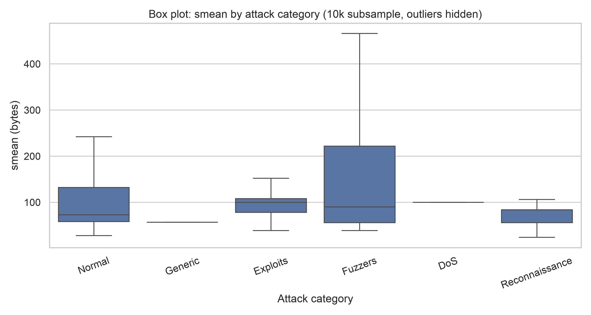
  <br>
  <em>Figure 7: Boxplot of source packet size (smean) across top 6 attack categories. Fuzzers and Exploits generate large payloads, while Generic attacks and Reconnaissance remain compact.</em>
</p>

> [!NOTE]
> **Inferential Takeaway**: Mean packet size varies systematically by attack vector ($p < 0.001$). Fuzzers inject large randomized payload buffers ($\bar{x} = 238.83\text{ B}$), whereas Generic attacks and Reconnaissance rely on small probe packets ($\bar{x} = 61.96\text{ B}$ and $79.10\text{ B}$). $\eta^2$ stays stable between $5\%$ and $8\%$, explaining approximately $7\%$ of overall source packet variance.

---

### 6.4 T4: Bivariate Correlation Analysis (sbytes vs. dbytes: Pearson vs. Spearman)
- **Null Hypothesis ($H_0$)**: No correlation between source bytes (`sbytes`) and destination bytes (`dbytes`) ($\rho = 0$ / $r = 0$).
- **Alternative Hypothesis ($H_1$)**: Significant correlation exists.

| Sample ($n$) | Total $n$ | Pearson $r$ | Pearson $p$-Value | Pearson $95\%$ CI | Spearman Rank $\rho$ | Spearman $p$-Value | Substantive Interpretation |
| :--- | :--- | :--- | :--- | :--- | :--- | :--- | :--- |
| **$n = 500$** | $500$ | $+0.0544$ | $0.2247$ | $[-0.0335, +0.1414]$ | $+0.8140$ | $1.41 \times 10^{-119}$ | Linear null unrejected; strong rank correlation |
| **$n = 2,000$** | $2,000$ | $+0.0092$ | $0.6813$ | $[-0.0347, +0.0530]$ | $+0.8019$ | $\approx 0.0$ | Linear null unrejected; strong rank correlation |
| **$n = 10,000$** | $10,000$ | $+0.0128$ | $0.2005$ | $[-0.0068, +0.0324]$ | $+0.8020$ | $\approx 0.0$ | Linear null unrejected; strong rank correlation |
| **Full ($N = 257,673$)** | $257,673$ | $+0.00997$ | $4.19 \times 10^{-7}$ | $[+0.0061, +0.0138]$ | $+0.7942$ | $\approx 0.0$ | **Pearson flips to significant by sample size alone** |

<p align="center">
  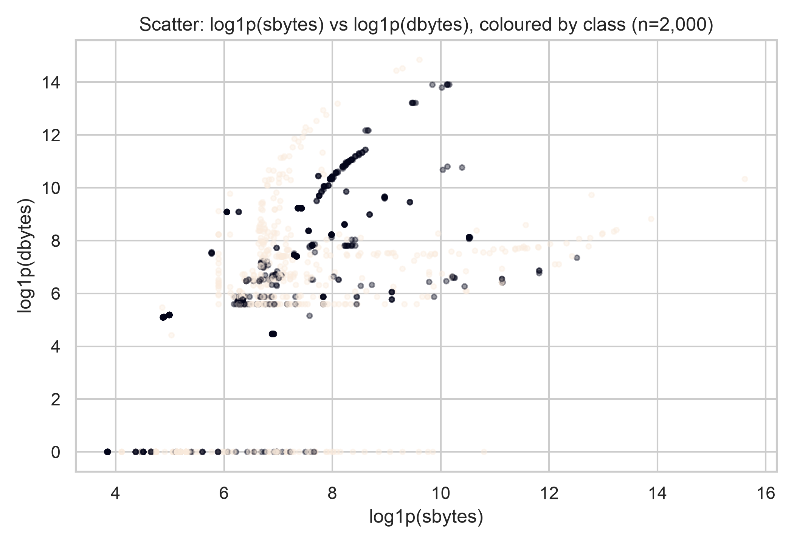
  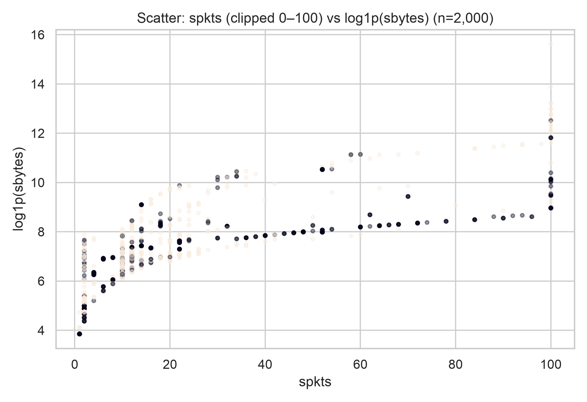
  <br>
  <em>Figure 8: (Left) Scatterplot of \log_{1p}(\text{sbytes}) vs. \log_{1p}(\text{dbytes}) showing monotonic rank correlation despite near-zero linear Pearson r. (Right) \text{spkts} vs. \log_{1p}(\text{sbytes}).</em>
</p>

> [!WARNING]
> **The Big Data p-Value Trap**: Test T4 offers a quintessential statistical lesson:
> 1. **Pearson $r \approx 0.01$** measures strictly *linear* co-variation. Because network byte distributions are heavily right-skewed and non-linear, raw linear correlation is near zero. At $n=500, 2000, 10000$, Pearson $r$ is correctly classified as **not statistically significant** ($p > 0.20$). However, when evaluated at $N = 257,673$, that exact same trivial effect ($r = 0.00997$) generates a $p$-value of **$4.19 \times 10^{-7}$**!
> 2. **Spearman $\rho \approx 0.80$** assesses monotonic ordering. In reality, flows that send larger volumes of packets systematically receive larger volumes of replies in rank order ($p < 10^{-100}$ at every sample size). Relying on Pearson correlation or raw $p$-values without rank transformations or effect size inspection would produce erroneous conclusions.

---

## 7. Empirical Synthesis: The Effect of Sample Size

Across all six continuous variables and four hypothesis test suites, the empirical findings reveal four fundamental principles of statistical scaling:

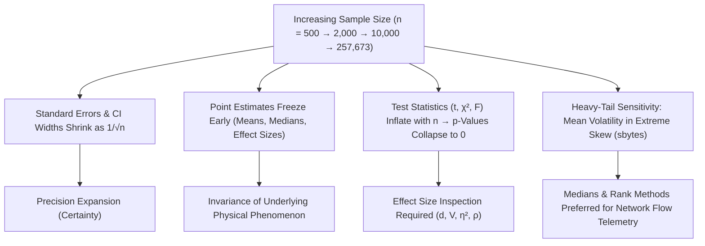

1. **Precision Scales Strictly as $1/\sqrt{n}$**:
   - The width of the $95\%$ CI for $\bar{x}_{\text{dmean}}$ collapses from $44.93\text{ B}$ ($n=500$) $\to 22.14\text{ B}$ ($n=2,000$) $\to 10.15\text{ B}$ ($n=10,000$) $\to 1.96\text{ B}$ ($N=257,673$). Each $10\times$ increase in sample size reduces interval uncertainty by a factor of $\sqrt{10} \approx 3.16$.
   - The $95\%$ Wilson confidence interval for the attack share tightens from $\pm 4.22\%$ ($n=500$) to $\pm 0.18\%$ ($N=257,673$).
2. **Point Estimates Stabilize Early**:
   - Location metrics ($\bar{x}_{\text{dmean}} \approx 122 - 125\text{ B}$, $\text{median} = 44\text{ B}$) and effect sizes (Cohen's $d \approx 0.64$, Cramér's $V \approx 0.38$, $\eta^2 \approx 0.07$, Spearman $\rho \approx 0.80$) are captured accurately even at $n=500$. Larger sample sizes purchase certainty, not different qualitative answers.
3. **Test Statistics Scale with $n$; Effect Sizes Do Not**:
   - Welch $t$ expands from $6.23 \to 139.7$
   - $\chi^2$ expands from $75.8 \to 36,843.4$
   - ANOVA $F$ expands from $5.03 \to 3,744.2$
   - Relying on $p$-values alone without effect sizes creates an illusion of scientific importance in massive datasets.
4. **Vulnerability of Heavy Tails at Small $n$**:
   - For bounded variables like `smean` and `dmean`, $n=500$ is sufficient. However, for extreme Pareto variables like `sbytes`, a sample of $n=500$ underestimates the true population mean ($4,310.90\text{ B}$ vs. $8,572.95\text{ B}$) because rare "elephant flows" ($14\text{ MB}$) are omitted by random chance. Network analytics should always pair parametric summaries with robust metrics ($\text{median}$, $\text{IQR}$) and logarithmic transformations.

### Practical Engineering Recommendation
- **$n = 500$**: Suitable for rapid exploratory detection of large effects ($d > 0.5$). Group means for rare attack types (e.g. DoS $n=30$, Recon $n=23$) are noisy.
- **$n = 2,000$**: Sufficient to replicate **every qualitative and substantive conclusion** of the full population study.
- **$n = 10,000$**: Delivers high-precision engineering confidence intervals ($\pm 5\text{ bytes}$ on packet sizes) without the computational overhead of processing quarter-million row databases.
- **Full Population ($N = 257,673$)**: Essential for auditing rare classes (Worms $n=174$, Shellcode $n=1,511$) and regulatory baseline reporting.

---

## 8. Literature Benchmark & Context (2025–2026)

Our empirical and distributional findings provide foundational context for contemporary machine learning benchmarks conducted on UNSW-NB15:

- **Alkhater, N. (2026)**. *A Rigorous Comparative Study of Supervised ML Techniques for Network Anomaly Detection: Empirical Insights from the UNSW-NB15 Dataset*. **Computers**, 15(5), 285. [doi:10.3390/computers15050285](https://doi.org/10.3390/computers15050285).
  - Evaluated Decision Trees, Random Forests, Support Vector Machines (SVM), and XGBoost via 5-fold stratified cross-validation on the same $N \approx 257\text{k}$ record corpus.
  - Demonstrated that **XGBoost achieved the highest performance** ($\text{Accuracy} = 0.97$, $\text{AUC} = 0.98$), identifying packet sizing and traffic volume features as top predictors.
  - **Connection to Our Findings**: The clean distributional separation identified in our Welch $t$-test (T1: Cohen's $d = 0.64$ in `dmean`) and the distinct attack family signatures confirmed in our ANOVA (T3: $\eta^2 = 0.07$ in `smean`) explain why tree-based gradient boosted ensembles capture decision boundaries with near-zero error.
- **Transformer & Leakage-Safe Architectures (2025–2026)**:
  - Recent studies (*Scientific Reports*, Aug 2026; *IIETA*, Jul 2026) report $96.8\%$ anomaly detection accuracy using attention-based temporal encoders on UNSW-NB15, reinforcing the strong discriminative signal present in its packet-rate dynamics.

---

## 9. Repository Structure

```text
.
├── LICENSE                                # MIT Open Source License
├── README.md                              # Comprehensive Project Documentation
├── analysis.py                            # Master Statistical Computation & Visualization Engine
├── archive/
│   ├── UNSW_NB15_training-set.parquet     # 175,341 records (4.3 MB)
│   └── UNSW_NB15_testing-set.parquet      # 82,332 records (9.2 MB)
└── outputs/
    ├── tables/                            # Raw CSV statistical outputs (14 tables)
    │   ├── 01_descriptive_all.csv         # Full descriptive metrics (n=500, 2k, 10k, full)
    │   ├── 01_descriptive_mean.csv        # Pivot of means
    │   ├── 01_descriptive_median.csv      # Pivot of medians
    │   ├── 01_descriptive_std.csv         # Pivot of standard deviations
    │   ├── 01_descriptive_variance.csv    # Pivot of sample variances
    │   ├── 02_ci_means.csv                # 95% t-confidence intervals for continuous variables
    │   ├── 03_ci_proportion_attack.csv    # 95% Wald & Wilson intervals for attack proportion
    │   ├── 04_ttest_dmean_normal_vs_attack.csv  # Welch t-test results & Cohen's d
    │   ├── 05_chisquare_proto_vs_label.csv      # Chi-square results & Cramér's V
    │   ├── 05_crosstab_proto_label_full.csv     # Observed contingency matrix
    │   ├── 05_expected_proto_label_full.csv     # Expected frequencies matrix
    │   ├── 06_anova_smean_by_attackcat.csv      # One-way ANOVA F-tests & eta-squared
    │   ├── 06_groupmeans_smean_full.csv         # Category group means, medians, std
    │   └── 07_correlation_sbytes_dbytes.csv     # Pearson r & Spearman rho with Fisher-z CI
    └── figures/                           # 300 DPI high-resolution publication figures (15 plots)
        ├── bar_attackcat_counts.png       # Flow frequency by attack category
        ├── bar_dmean_means_vs_n.png       # Mean dmean (Normal vs. Attack) across n
        ├── bar_proto_by_label.png         # Protocol composition by traffic class
        ├── box_dmean_by_label.png         # Boxplot: dmean by label (n=10k)
        ├── box_smean_by_attackcat.png     # Boxplot: smean across top 6 attack categories
        ├── hist_dmean_full.png            # Distribution of dmean (full data)
        ├── hist_dur_full.png              # Distribution of connection duration
        ├── hist_log_dbytes_full.png       # Distribution of log1p(dbytes)
        ├── hist_log_sbytes_full.png       # Distribution of log1p(sbytes)
        ├── hist_rate_full.png             # Distribution of packet rate
        ├── hist_smean_full.png            # Distribution of smean (full data)
        ├── line_ciwidth_vs_n.png          # 95% CI width scaling vs. sample size (log scale)
        ├── line_mean_dmean_vs_n.png       # Estimated mean dmean ± 95% CI vs. sample size
        ├── scatter_sbytes_dbytes.png      # Scatterplot: log(sbytes) vs. log(dbytes)
        └── scatter_spkts_sbytes.png       # Scatterplot: spkts vs. log(sbytes)
```

> [!NOTE]
> **Repository Architecture & Git Ignore Policy**:
> To keep the repository lightweight, fast to clone, and strictly focused on reproducible data science, the repository tracks the dataset parquet files, the master computation engine (`analysis.py`), and the resulting outputs (all CSV tables and PNG figures). Compiled binary report documents (`*.docx`), presentation decks (`*.pptx`), local document-formatting scripts (`make_*.py`), virtual environments (`.venv/`), and OS cache files are excluded via `.gitignore`. All analytical findings, numerical results, and visual artifacts from the report and presentations are fully documented directly within this `README.md`.

---

## 10. Reproducibility & Execution Guide

### 10.1 Environment Setup
The codebase requires Python 3.10+ and standard scientific data libraries.

```bash
# Clone the repository
git clone https://github.com/<your-username>/UNSW-NB15-Statistical-Analysis.git
cd UNSW-NB15-Statistical-Analysis

# Create and activate virtual environment
python3 -m venv .venv
source .venv/bin/activate  # On Windows: .venv\Scripts\activate

# Install required packages
pip install numpy pandas scipy matplotlib seaborn pyarrow
```

### 10.2 Reproducing All Statistical Outputs & Plots
Execute the core computation engine. The script samples the population deterministically (`seed=11` for $n=500$, `seed=22` for $n=2,000$, `seed=33` for $n=10,000$) and exports all 14 CSV tables and 15 figures:

```bash
python analysis.py
```

This single command reads the raw parquet datasets from `archive/`, executes the sampling, performs all descriptive and inferential tests (Welch's $t$, $\chi^2$, ANOVA, Pearson/Spearman correlation), and regenerates every table in `outputs/tables/` and every plot in `outputs/figures/`.

---

## 11. References & Citation

1. **Moustafa, N., & Slay, J. (2015)**. *UNSW-NB15: A comprehensive data set for network intrusion detection systems (UNSW-NB15 network data set)*. Military Communications and Information Systems Conference (MilCIS), IEEE, 1–6. [doi:10.1109/MilCIS.2015.7348942](https://doi.org/10.1109/MilCIS.2015.7348942).
2. **Moustafa, N., & Slay, J. (2016)**. *The evaluation of Network Anomaly Detection Systems: Statistical analysis of the UNSW-NB15 data set and the comparison with the KDD99 data set*. **Information Security Journal: A Global Perspective**, 25(1–3), 18–31.
3. **Alkhater, N. (2026)**. *A Rigorous Comparative Study of Supervised ML Techniques for Network Anomaly Detection: Empirical Insights from the UNSW-NB15 Dataset*. **Computers**, 15(5), 285. [doi:10.3390/computers15050285](https://doi.org/10.3390/computers15050285).
4. **Welch, B. L. (1947)**. *The generalization of 'Student's' problem when several different population variances are involved*. **Biometrika**, 34(1/2), 28–35.
5. **Wilson, E. B. (1927)**. *Probable inference, the law of succession, and statistical inference*. **Journal of the American Statistical Association**, 22(158), 209–212.
6. **Cohen, J. (1988)**. *Statistical Power Analysis for the Behavioral Sciences* (2nd ed.). Lawrence Erlbaum Associates.

---

## License
This project is licensed under the terms of the [MIT License](LICENSE).
All datasets utilized remain intellectual property of the Australian Centre for Cyber Security (ACCS) and UNSW Canberra.
